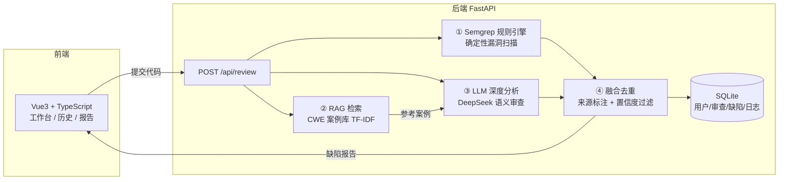

# 智能代码审查系统 Intelligent Code Review System

基于「LLM 大模型 + Semgrep 规则引擎 + RAG 检索」三引擎融合的智能代码审查平台，实现代码缺陷的自动检测、风险分级与修复建议生成，支持多用户与审查历史持久化。

## 系统架构



### 审查流水线

1. **Semgrep 规则引擎**：确定性漏洞扫描（SQL 注入 / XSS / 硬编码密钥 / eval 等）
2. **RAG 检索增强**：内置 13 类 CWE 缺陷案例库，TF-IDF + 余弦相似度检索，为缺陷附上参考修复代码
3. **LLM 深度分析**：DeepSeek（OpenAI 兼容）做语义级分析，找出规则无法覆盖的逻辑缺陷；带置信度评分与重试降级
4. **融合去重**：规则 + LLM 结果合并，每条缺陷标注来源（规则 / LLM），低置信度 LLM 缺陷自动过滤

## 目录结构

```
.
├── backend/               # FastAPI 后端（Semgrep + LLM + RAG + SQLite + JWT）
├── code-review-frontend/  # Vue3 + TypeScript 前端
└── code-review.html       # 最初的前端静态原型（单文件，双击可打开）
```

## 快速开始

### 后端（需 Python 3.10+，已装 Semgrep）

```bash
cd backend
pip install -r requirements.txt
cp .env.example .env        # 可选：填入 DeepSeek API Key 启用 LLM
python run.py               # 启动 http://127.0.0.1:8000
```

### 前端（需 Node 18+）

```bash
cd code-review-frontend
npm install
npm run dev                 # 启动 http://localhost:5173
```

浏览器打开 http://localhost:5173，登录演示账号 **demo / demo123**（首次启动自动预置）。

## 对比实验

`backend/benchmark.py` 对比三种模式（Semgrep 单独 / LLM 单独 / 三引擎融合）的检出率、准确率、误报率。

> 在 6 个样本、36 处标注缺陷上：**融合方案检出率 100%（0 漏报）**，由纯规则引擎的 41.7% 提升而来；LLM 单独检出率 80.6%。
>
> 融合方案另内置**置信度过滤**（对 LLM 缺陷按 confidence 阈值过滤）以控制误报，可用 `python backend/benchmark.py` 复现评测。

### 阈值敏感性实验

`python backend/benchmark.py --sweep` 固定 LLM 输出、扫描置信度阈值（0.3 ~ 0.9），观察检出率与准确率的权衡：

| 阈值 | 报告数 | 命中 | 漏报 | 误报 | 检出率 | 准确率 | F1 |
|:---:|---:|---:|---:|---:|---:|---:|---:|
| 0.3 | 51 | 36 | 0 | 15 | 100.0% | 70.6% | 82.8% |
| 0.4 | 51 | 36 | 0 | 15 | 100.0% | 70.6% | 82.8% |
| 0.5 | 51 | 36 | 0 | 15 | 100.0% | 70.6% | 82.8% |
| 0.6 | 50 | 36 | 0 | 14 | 100.0% | 72.0% | 83.7% |
| **0.7** | 49 | 36 | **0** | 13 | **100.0%** | 73.5% | 84.7% |
| 0.8 | 39 | 34 | 2 | 5 | 94.4% | 87.2% | **90.7%** |
| 0.9 | 26 | 24 | 12 | 2 | 66.7% | 92.3% | 77.4% |

> **结论**：**0.7 是保持零漏报（100% 检出率）的最大阈值**。若优先降低误报，0.8 的 F1 更优，但会漏掉 2 处缺陷。系统默认取 0.7，即「零漏报优先」——代码审查场景中漏报的代价远大于误报。

### RAG 消融实验

`python backend/ablation_rag.py` 对比「启用 RAG」与「关闭 RAG」两组，除 RAG 外流水线完全一致。评价修复建议「具体度」的关键词表由人工按缺陷语义独立定义，不取自 RAG 语料，避免循环论证。

| 指标 | 关闭 RAG | 启用 RAG |
|:---|---:|---:|
| 规则缺陷附 **CWE 编号**覆盖率 | 0.0% | **100.0%** |
| 规则缺陷附 **参考修复代码**覆盖率 | 0.0% | **100.0%** |
| 缺陷报告总数 | 51 | 48 |
| 全部缺陷修复建议平均长度 | 55.8 字 | 60.3 字 |
| LLM 缺陷修复建议平均长度 | 66.0 字 | 73.5 字 |
| 命中缺陷的修复具体度 | 64.7% | 63.9% |
| 其中 LLM 缺陷的修复具体度 | 62.5% | 64.0% |

> **结论**：RAG 的价值主要体现在**结构化增强**——为规则缺陷补上标准 CWE 编号与可直接参考的修复代码，覆盖率从 0% 提升到 100%，这是确定性收益。
>
> 而将检索案例注入 LLM Prompt 这一层，修复建议的**具体度提升不显著**（62.5% → 64.0%），但平均长度增加约 11%（66.0 → 73.5 字），说明案例主要起"补充细节"作用。对 SQL 注入、XSS 这类通用缺陷，修复手段本就在大模型已有知识内，检索案例的边际收益有限。
>
> **局限**：LLM 输出非确定性，本结果为单次运行（两组缺陷总数 51 / 48 的差异也源于此）；样本量 6 个，统计效力有限。

## 界面截图

> 运行系统后可将截图放入 `docs/` 目录，替换下方占位引用：

| 登录页 | 审查工作台 | 审查结果 |
|:---:|:---:|:---:|
|  |  |  |

## 技术栈

Vue3 · TypeScript · Tailwind CSS · Chart.js · Pinia · Vue Router · FastAPI · SQLAlchemy · SQLite · Semgrep · DeepSeek · RAG · JWT
